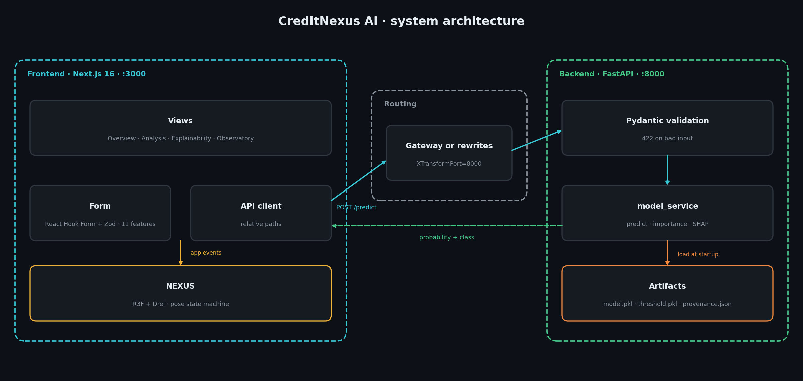
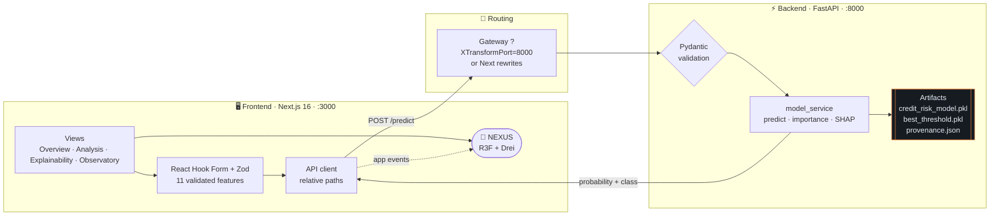
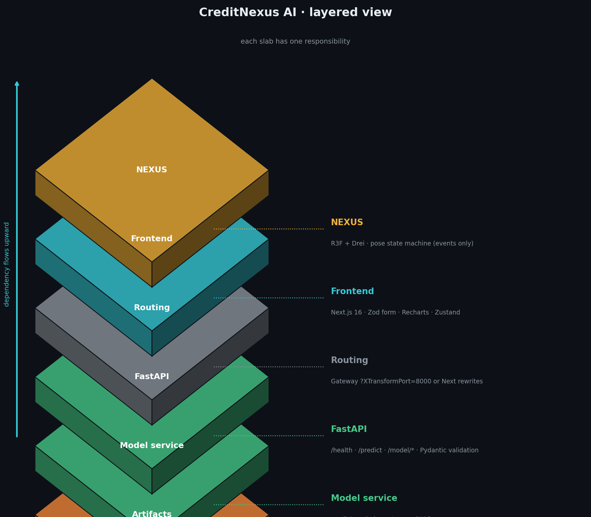
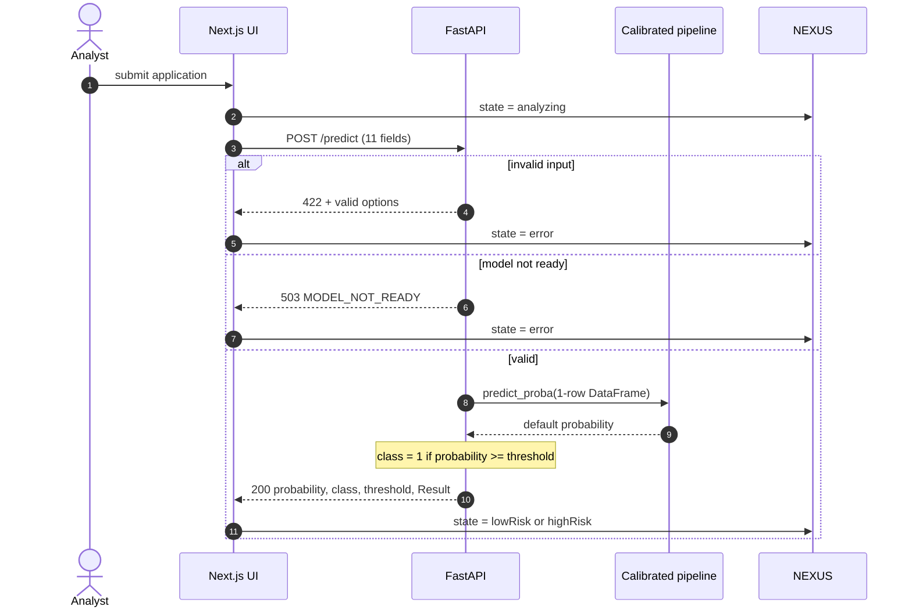
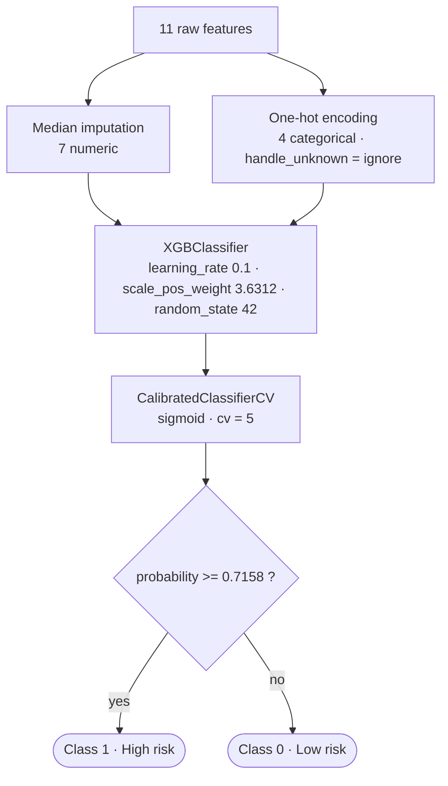
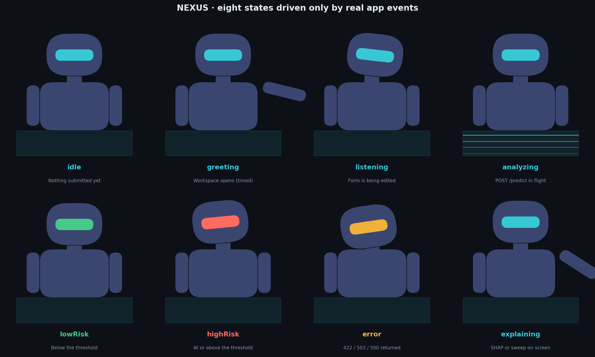
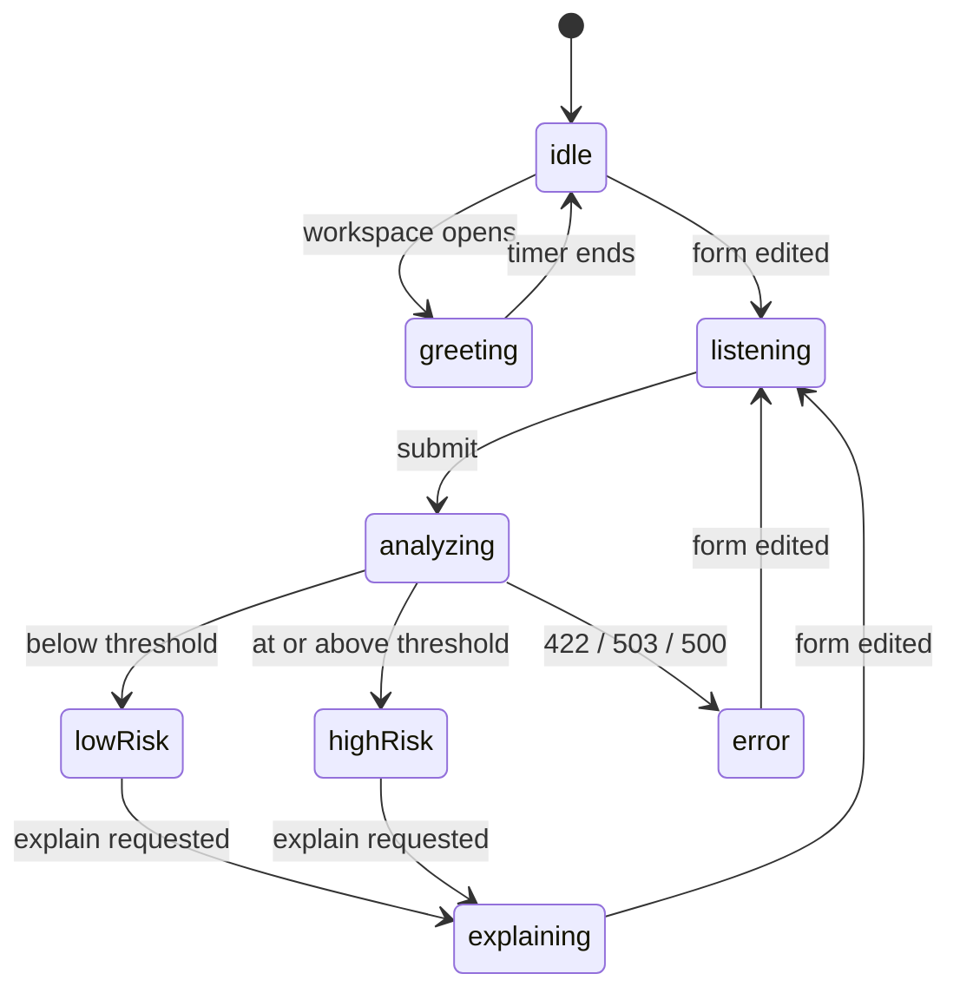

<div align="center">

# 🧿 CreditNexus AI

### Understand Risk. Explore Intelligence.

### An immersive, 3D-first credit risk workstation: a calibrated XGBoost model serves live loan-default probabilities while NEXUS, a persistent 3D AI analyst, reacts to every application state.

<br>


<br>

| 🎯 Task | 🌲 Model | 📈 ROC-AUC | 🎚️ F1 | 🧪 Holdout rows | 🚦 Threshold |
|:---:|:---:|:---:|:---:|:---:|:---:|
| Binary classification | XGBoost + sigmoid calibration | **0.949** | **0.837** | 6,305 | **0.7158** |

<br>



</div>

<!-- DEMO: drop your demo video / GIF here, e.g.
<p align="center"><a href="YOUR_YOUTUBE_LINK"></a></p>
-->

> **Scope.** This is a **loan / credit default risk** project (target `loan_status`). It is **not** credit-card transaction fraud detection.

---

## 📑 Table of Contents

- [✨ Highlights](#-highlights)
- [🧱 Architecture](#-architecture)
  - [2D system view](#2d-system-view)
  - [3D layered view](#3d-layered-view)
  - [Request lifecycle](#request-lifecycle)
  - [Inference pipeline](#inference-pipeline)
- [🤖 Meet NEXUS](#-meet-nexus)
- [🔍 The Audit Story](#-the-audit-story)
- [📊 Results](#-results)
- [🧭 Explainability](#-explainability)
- [🖥️ Product Surface](#️-product-surface)
- [🚀 Quick Start](#-quick-start)
- [🔌 API Reference](#-api-reference)
- [📁 Project Structure](#-project-structure)
- [🛠️ Troubleshooting](#️-troubleshooting)
- [🚧 Limitations & Honest Notes](#-limitations--honest-notes)
- [🚦 Roadmap](#-roadmap)
- [👤 Author](#-author)

---

## ✨ Highlights

- **One contract, zero drift.** The backend takes the raw 11-feature payload and the pipeline handles encoding internally, so the API never re-implements preprocessing.
- **Threshold always in view.** Every result shows the probability, the 0.7158 cut-off and the exact arithmetic that produced the class. Predicted probability is never confused with classification correctness.
- **A model that fails loudly.** At startup the service verifies the artifact exposes `predict_proba` and refuses to report ready otherwise. The silent failure that shipped in the original artifact cannot recur.
- **Transparent provenance.** Measured metrics and notebook-reported metrics are shown separately and never mixed. A verification record ships with the model.
- **Explainability built in.** Global gain importance, local SHAP waterfalls and single-input sensitivity sweeps, where every point is a live prediction.
- **A 3D analyst that cannot lie.** NEXUS is driven only by real application events. It never creates or alters a prediction.
- **Graceful degradation.** No WebGL, a renderer crash, a weak GPU or reduced-motion preference all have defined fallbacks, and every feature keeps working.
- **Tested.** 39 backend tests against the real artifacts and 41 frontend tests.

---

## 🧱 Architecture

Two parts meet at one boundary: a **Next.js frontend** with a 3D analyst, and a **FastAPI service** that loads the model artifacts once at startup.

### 2D system view

<div align="center">

</div>



### 3D layered view

Each slab is a layer with a single responsibility.

<div align="center">

</div>

### Request lifecycle



### Inference pipeline



---

## 🤖 Meet NEXUS

A procedural Three.js analyst (graphite suit, emissive visor, holo console). No GLB dependency, and the component is structured for a drop-in rigged model.

<div align="center">

</div>

| State | Triggered by |
|---|---|
| `idle` | Nothing submitted yet |
| `greeting` | Workspace opens (timed) |
| `listening` | Form is being edited |
| `analyzing` | `POST /predict` in flight, scan sweep runs |
| `lowRisk` | Probability below the threshold |
| `highRisk` | Probability at or above the threshold, brief head-shake |
| `error` | A 422, 503 or 500 came back |
| `explaining` | SHAP or sensitivity results on screen |



> Simplified view. Poses use damped interpolation, so every transition is interruptible.

**Degradation ladder**

| Condition | Behavior |
|---|---|
| WebGL unavailable | Static fallback, all features remain functional |
| Renderer crashes at runtime | Error boundary swaps in the fallback |
| Weak GPU | `PerformanceMonitor` lowers pixel ratio and particle count |
| `prefers-reduced-motion` or low-performance toggle | Ambient motion stops |

---

## 🔍 The Audit Story

The original repository was audited before any code was written. One critical defect was found and handled openly.

| Artifact | Finding | Resolution |
|---|---|---|
| `best_threshold.pkl` | Valid. `0.7158444761787314`, the notebook's F1-optimal threshold on the calibrated scale | Used **verbatim, unmodified** |
| `credit_risk_model.pkl` | **Not a model.** Notebook cell 81 reassigns `calibrated_model` to `predict_proba(X_test)[:,1]`, and cell 82 dumps that: a 6,305-element probability array. The original `main.py` crashed on every `/predict` call | The intended pipeline (notebook cells 13 to 60) was re-executed on the verified dataset. The rebuild reproduces the uploaded array to **max abs diff 2.6e-05 (Pearson r = 1.0)** |
| `main.py` | Contract is sound | Preserved byte-for-byte |

The dataset (`credit_risk_dataset.csv`, Kaggle *laotse/credit-risk-dataset*, CC0) was not in the upload. It was obtained and checked against **26 of 26** statistics printed by the notebook (row and column counts, means, ranges, null counts, duplicates, class balance, cardinalities) before the rebuild. The full record is in `mini-services/credit-risk-api/artifacts/provenance.json`.

---

## 📊 Results

Measured on the serving artifact over a **6,305-row holdout** never used for training.

| Metric | Value |
|---|:---:|
| Accuracy | **0.938** |
| Precision | **0.978** |
| Recall | **0.731** |
| F1 | **0.837** |
| ROC-AUC | **0.949** |
| Average precision | **0.902** |

**How to read it.** When the model flags a loan as high risk it is right about 98% of the time, but it catches only about 73% of real defaulters, so roughly 27% are classed low risk. The 0.7158 threshold trades recall for precision. Notebook-reported values appear separately in the Observatory and are never blended with these measured ones.

---

## 🧭 Explainability

| Tool | What it shows | Method |
|---|---|---|
| **Global importance** | Which of the 11 features drive the model | Gain importance, aggregated from one-hot columns back to the original features |
| **Local SHAP waterfall** | Why one application scored as it did | `TreeExplainer` on the uncalibrated pipeline, following the notebook |
| **Sensitivity sweeps** | How the score moves as one input changes | Every point is a live `/predict` call |

<div align="center">

</div>

---

## 🖥️ Product Surface

- **Overview.** Hero 3D chamber, verified model facts and live backend status.
- **Analysis Workspace.** Four-section validated form with training-range checks, an `employment <= age` rule, ratio auto-compute, three illustrative samples and review-before-submit. Results show a radial gauge, threshold marker, probability bar and the exact classification arithmetic.
- **Explainability Lab.** Global importance, SHAP waterfall and sensitivity sweeps.
- **Model Observatory.** Service status, client-measured latency sparkline, pipeline map, live feature schema, measured vs notebook-reported metrics, provenance and limitations.
- **Extras.** Command palette (`Ctrl/⌘ K`), session-only activity timeline, view shortcuts (`1` to `4`) and responsive mobile tabs.

<div align="center">

</div>

---

## 🚀 Quick Start

### Prerequisites

- Python 3 with `pip`
- [Bun](https://bun.sh) for the frontend

### 1 · Backend (FastAPI + real model artifacts)

```bash
cd mini-services/credit-risk-api
python3 -m venv .venv && source .venv/bin/activate   # optional
pip install -r requirements.txt
python3 -m uvicorn app.main:app --host 0.0.0.0 --port 8000
# or: bun run dev   (package.json script, --reload enabled)
```

Health check:

```bash
curl http://localhost:8000/health
```

### 2 · Frontend

```bash
bun install
bun run dev          # http://localhost:3000
```

The frontend reaches the backend through relative paths:

| Mode | How |
|---|---|
| Sandbox gateway | `/predict?XTransformPort=8000` |
| Direct local dev | Next.js rewrites proxy `/predict`, `/health`, `/model/*` to `http://localhost:8000` (override with `CREDIT_RISK_API_ORIGIN`) |
| Bypass both | Set `NEXT_PUBLIC_API_BASE_URL` |

### 3 · Tests

```bash
# Backend: 39 tests against the real artifacts
cd mini-services/credit-risk-api && python3 -m pytest tests -v

# Frontend: 41 tests (schema, API client, stores, pose engine, panels)
bun run test
```

### 4 · Swap in your own model artifact *(optional)*

Fix the notebook's save cell so it dumps the estimator, not the array:

```python
# Cell 82, corrected
import joblib
joblib.dump(calibrated_model_xg, "credit_risk_model.pkl")
```

Replace `mini-services/credit-risk-api/artifacts/credit_risk_model.pkl` and restart. No code changes are needed. `best_threshold.pkl` is already your original file.

---

## 🔌 API Reference

### `POST /predict`

Identical to the original backend contract.

**Request body**

| Field | Type | Notes |
|---|---|---|
| `person_age` | int | Training-range checked |
| `person_income` | number | Annual income |
| `person_home_ownership` | string | Categorical, e.g. `RENT` |
| `person_emp_length` | number | Years. Must not exceed age |
| `loan_intent` | string | Categorical, e.g. `PERSONAL` |
| `loan_grade` | string | Categorical, e.g. `C` |
| `loan_amnt` | number | Loan amount |
| `loan_int_rate` | number | Interest rate, percent |
| `loan_percent_income` | number | Loan as a fraction of income |
| `cb_person_default_on_file` | string | `Y` or `N` |
| `cb_person_cred_hist_length` | number | Years of credit history |

> Valid category values come from the live encoder. `GET /model/info` lists them, and a `422` for an unknown category returns the valid options.

**Example**

```bash
curl -X POST http://localhost:8000/predict \
  -H "Content-Type: application/json" \
  -d '{
    "person_age": 30, "person_income": 55000,
    "person_home_ownership": "RENT", "person_emp_length": 4,
    "loan_intent": "PERSONAL", "loan_grade": "C",
    "loan_amnt": 10000, "loan_int_rate": 12.5,
    "loan_percent_income": 0.18,
    "cb_person_default_on_file": "N", "cb_person_cred_hist_length": 4
  }'
```

**Response `200`**

```json
{
  "default_probability": 0.043462101407450215,
  "default_prediction": 0,
  "threshold": 0.7158444761787314,
  "Result": "Low risk"
}
```

Classification rule: `class = 1 if probability >= threshold`.

### Additional endpoints

| Endpoint | Purpose |
|---|---|
| `GET /health` | Readiness, model-loaded status, artifact kind, uptime |
| `GET /model/info` | Pipeline structure, feature schema, threshold, provenance, measured and notebook metrics, limitations |
| `GET /model/feature-importance` | Gain importance aggregated to the 11 original features |
| `POST /model/explain` | Local SHAP explanation |

All are verified-metadata only. No internals are leaked.

### Error semantics

| Status | Meaning |
|---|---|
| `422` | Invalid input. Unknown categories return the valid options |
| `503 MODEL_NOT_READY` | Artifacts failed validation at startup |
| `500 INFERENCE_FAILED` | Generic message. Details only in server logs |

Every response carries an `X-Request-ID`.

**Python client**

```python
import requests

payload = {
    "person_age": 30, "person_income": 55000,
    "person_home_ownership": "RENT", "person_emp_length": 4,
    "loan_intent": "PERSONAL", "loan_grade": "C",
    "loan_amnt": 10000, "loan_int_rate": 12.5,
    "loan_percent_income": 0.18,
    "cb_person_default_on_file": "N", "cb_person_cred_hist_length": 4,
}
r = requests.post("http://localhost:8000/predict", json=payload, timeout=10)
print(r.json())
```

---

## 📁 Project Structure

```
.
├── src/                              # Next.js frontend (components, features, stores)
│   └── components/three/             # AnalystScene, NexusCharacter, poseEngine
├── mini-services/credit-risk-api/    # FastAPI service
│   ├── app/                          # main.py, model_service, routes
│   ├── artifacts/                    # credit_risk_model.pkl, best_threshold.pkl, provenance.json
│   ├── tests/                        # 39 backend tests
│   └── tools/rebuild_model.py        # Reproducible verified rebuild of the intended model
├── scripts/                          # Audit notes and verification screenshots
├── upload/                           # Original files (never modified)
└── assets/                           # README images
```

---

## 🛠️ Troubleshooting

| Symptom | Cause | Fix |
|---|---|---|
| `503 MODEL_NOT_READY` | The artifact does not expose `predict_proba` | Export the estimator, not an array (see [Swap in your own model](#4--swap-in-your-own-model-artifact-optional)) |
| `422` on `/predict` | Out-of-range value or unknown category | Read the response. It lists the valid options |
| `500 INFERENCE_FAILED` | Unexpected inference error | Find the `X-Request-ID` from the response in the server logs |
| Frontend cannot reach the API | Backend not running, or wrong origin | Start the backend on `:8000`, or set `CREDIT_RISK_API_ORIGIN` or `NEXT_PUBLIC_API_BASE_URL` |
| NEXUS shows a flat illustration | WebGL unavailable or renderer crashed | Expected fallback. All features still work |
| Browser blocks API calls | Origin is not in the allowed CORS list | Add your origin to the configured CORS origins |

---

## 🚧 Limitations & Honest Notes

This is a **portfolio and learning project**, not a lending system.

- **Not a lending decision.** Outputs are model estimates, not guarantees. No compliance claims are made.
- **Rebuilt artifact.** The served model is a verified rebuild of the intended pipeline, not the original export, which was a probability array.
- **Recall is 0.731.** About 27% of real defaulters in the holdout are classed low risk.
- **Public dataset.** Training data is a public Kaggle dataset, not lender data. Behavior on real portfolios is unknown.
- **Threshold provenance.** The 0.7158 cut-off comes from the notebook. Confirm it was chosen on data separate from the 6,305-row holdout before quoting the metrics as unbiased.
- **No fairness audit.** Features such as age and home ownership are included, and no bias analysis is reported.
- **Probability is not correctness.** A predicted default probability and classification accuracy are different things, and the UI keeps them apart.
- **Privacy.** Applicant data goes only to this deployment's inference service. It is never logged, stored or forwarded to external AI services. Logs hold request IDs and status codes only.

---

## 🚦 Roadmap

- [ ] Re-export the original model with the corrected cell 82
- [ ] Select the threshold on a validation split and report on an untouched test set
- [ ] Fairness and bias analysis
- [ ] Model card documenting data provenance and intended use
- [ ] Swap the procedural NEXUS for a rigged GLB model
- [ ] Dockerfile and CI on push
- [ ] Pin all dependency versions

---

## 👤 Author

**Yash Brahmankar**. B.Tech, Artificial Intelligence & Machine Learning · Oriental Institute of Science & Technology, Bhopal

[](https://github.com/loisekk)

Released under the [MIT License](LICENSE). Dataset: Kaggle *laotse/credit-risk-dataset* (CC0). If this project helped you, a ⭐ is appreciated.
